# **A2 Computer Science 真题知识点整理**

by  *[m0no3van](https://github.com/m0no3van)*

## CH-13 Data Representation

### 13.1 User-defined data types

#### Purpose of user-defined data type: 

1.   To extend the flexibility of the programming language
2.   To create a new data type (from existing data types)

#### Explain what is meant by **non-composite** and **composite** data types s24-31-3 [3 marks]

*One mark per mark point (Max 2)  non-composite data types*  

-   MP1 Non-composite data types can both be user-defined or primitive  
-   MP2 Non-composite data types do not refer to other data types in their definition / contain one data type in their  definition  
-   MP3 Non-composite data types can be primitive/enumerated/pointer

*One mark per mark point (Max 2)  composite data types*  
-   MP4 Composite data types can be user-defined or primitive  
-   MP5 Composite data types refer to other data types in their definition/contain more than one data type in their  definition  
-   MP6 Composite data types can be record/set/class 

#### Describe the user-defined data type set. [3 marks] w24-31-6

*One mark per mark point (Max 3)*   

-   MP1 A set user-defined data type is a composite data type  
-   MP2 … which includes a list of unordered elements  
-   MP3 Set theory operations, such as intersection and union, can be applied to these elements  
-   MP4 A set data type includes the type of data/data type it uses as part of its definition  
-   MP5 All the elements are of the same data type. 

### 13.2 File Organisation and Access

#### 比较Sequential and serial access  w21-31-5

#### Compare sequential and serial methods of file organisation [4 marks]

-   In both serial and sequential files records are stored one after the other ...
-   ... and need to be accessed one after the other 
-   Serial files are stored in chronological order
-   Sequential files are stored with ordered records. 
-   ... and stored in the order of the key field
-   In serial files, new records are added in the next available space / records are appended to the file
-   In sequential files, new records are inserted in the correct position. 

>   Sequential是按照 **Key field** 排序的, Serial 是按照 **时间** 排序的
>
>   **3种** file organisation: Serial, Sequential, Random
>
>   **2种** file access: Direct, Sequential

####  Describe the sequential method as file **access** s24-31-4 [2 marks]

-   Sequential access method searches for **records** one after the other 
-   ... from the physical start of the file until the **record** is found/the end of file.

#### Explain how the sequential method of file access is applied to files with serial organisation and to files with sequential organisation s21-31-4 [3 marks]

-   MP1 For serial files, records are stored in chronological order  
-   MP2 … every record needs to be checked until the record is found, or all records have been checked.  
-   MP3 For sequential files, records are stored in order of a key field/index, and it is the key field/index that is compared.  
-   MP4 … every record is checked until the record is found, or the key field of the current record is greater than the key  field of the target record. 

#### Outline what is meant by direct access as a method of file access. s24-31-7 [2 marks]

*One mark per mark point (Max 2)* 

-   MP1 Direct access allows a record to be found in a file without other records being read.  
-   MP2 Records are found by using the key field of the target record // the location of the record is found using a  hashing algorithm. 

#### Explain how direct access is used to locate a specific record in sequential files. s24-31-7 [2 marks]

*One mark per mark point (Max 2)*  

-   MP1 In sequential files, an index of all key fields is kept  
-   MP2 The index is searched for the address of the file location where the target record is stored. 

#### Explain how direct access is used to locate a specific record in random files. s24-31-7 [2 marks]

*One mark per mark point (Max 2)*  

-   MP1 A hashing algorithm is used on the key field of the record  
-   MP2 … to calculate the address of the memory location where the target record is expected to be stored.  
-   MP3 Method to find a record if it is not at the expected location e.g. linear probing, search overflow area etc. 

#### Explain what is meant by a hashing algorithm in the context of file access.  [3 marks] w24-31-5

*One mark per mark point (Max 3)*   

-   MP1 A hashing algorithm is used in direct access methods on random and sequential files  \
-   MP2 It is a mathematical formula   
-   MP3 … used to perform a calculation applied to the key field of the record being searched / stored  
-   MP4 The result of the calculation gives the address where the record should be found / stored. 

#### The use of a hashing algorithm can result in the same storage location being identified for  more than one record.  Outline **two** methods of overcoming this issue. [2 marks] w24-31-5

*One mark per mark point (Max 2)*   

-   MP1 The record is stored in the next free memory space after the one identified by the hashing algorithm // Use  linear progression  
-   MP2 An overflow area is set up and the record is stored in the next free memory space in the overflow area. 

### 13.3 Floating-point Numbers 

**这一章主要是方法, 背诵的不多**

#### 负数十进制转浮点正指数 s21-31-1a

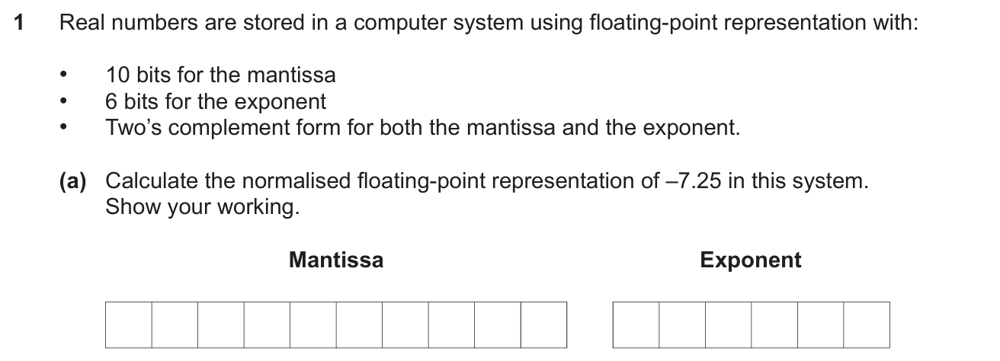

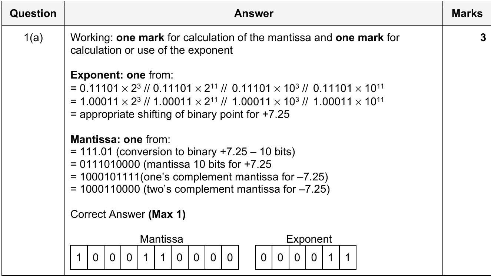

在把一个十进制小数转换成Floating-point number的时候, 我们分类讨论: 这个二进制数是正的还是负的

如果这个数字是负的, 先需要把这个十进制小数转换成二进制小数比如我们先拿7.25举例
$$
-7.25 = -(1* 2^2 + 1* 2^1+1*2^0+0*2^{-1}+ 1* 2^{-2} )= - 111.01_{(2)}
$$
接下来我们把小数点向前移动, 知道我们的开头是0.1......
$$
-111.01_{(2)} = -0.11101_{(2)} * 2^3
$$


这个时候我们的Exponent就可以的出来了
$$
Exponent = 3 = 2^1+2^0 = 11_{(2)}
$$
然后就是mantissa, 只需要把011101转成 one's complement code 再转成two's complement code, 后面补足0就行. Mantissa是从左往右生长, Exponent是从右往左生长. 我们如果追求完美的话可以直接不带负号, 这样更加完美踩到 mark scheme. 

#### 负数浮点数转十进制正指数 s21-31-1b

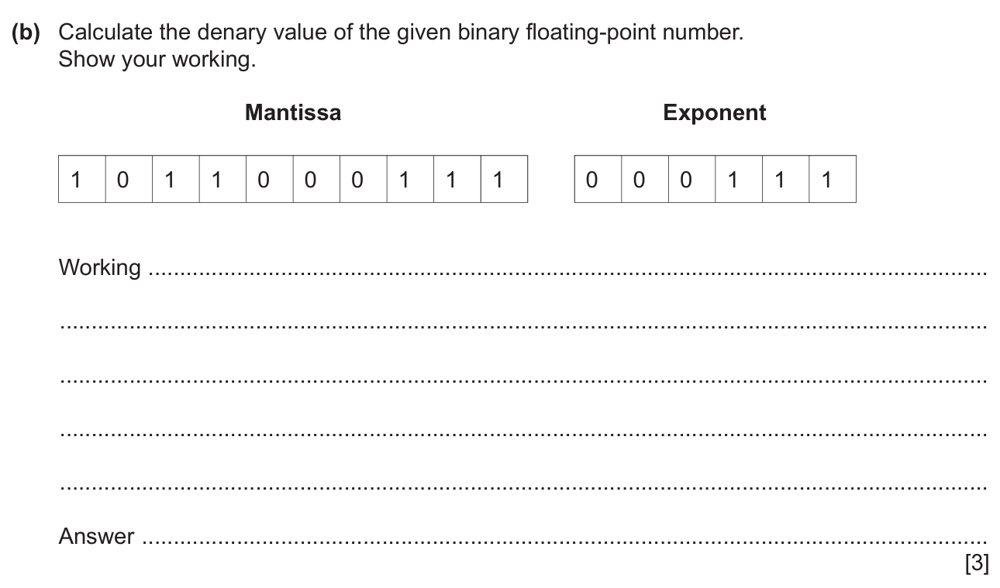

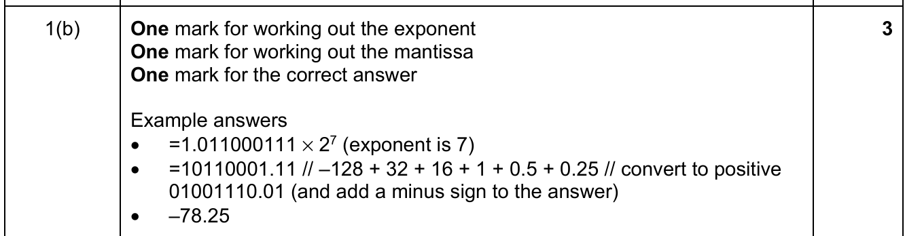

浮点数转十进制比较无脑, 我们知道, Mantissa的构成是固定的

| 对应的乘数 | $-2^0=-1$ | $2^{-1}$ | $2^{-2}$ | $2^{-3}$ | $2^{-4}$ | $2^{-5}$ | $2^{-6}$ | $2^{-7}$ | ...  |
| ---------- | --------- | -------- | -------- | -------- | -------- | -------- | -------- | -------- | ---- |
| 二进制数   |           |          |          |          |          |          |          |          |      |

同时, Exponent 的构成也是有迹可循的

| 对应的乘数 | $-2^{n}$(这里由于补码会有个负号) | ...  | $2^1$ | $2^0=1$ |
| ---------- | -------------------------------- | ---- | ----- | ------- |
| 二进制数   |                                  |      |       |         |

先把Exponent算出来, 再把Mantissa算出来, 最后$Value = Mantissa * 2^{Exponent}$

#### Overflow of Mantissa s21-31-1d

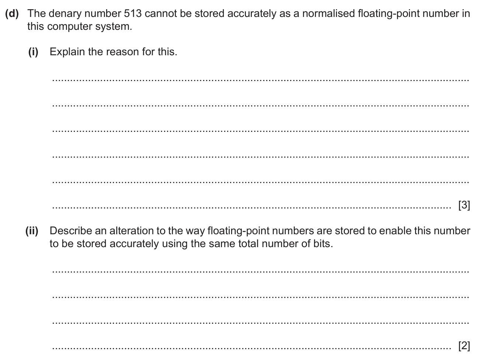

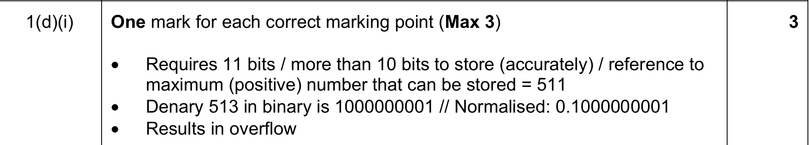

为什么floating point number存不下: 

i) 

首先先把他转成二进制, 讲出来: The binary of {数字} is {二进制}, Normalised: {normalised 数字}

然后数位数, mantissa基本都是overflow (significant bits太多): Requires {个数} bits, more than {个数} to store accurately 

然后点出: Results in overflow. 

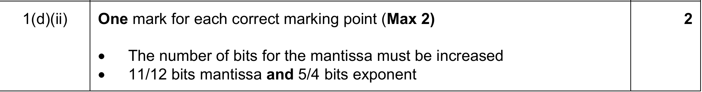

存不下怎么办

ii) 

The number of bits for the mantissa must be increased (overflow)

给以一个具体方法, 从exponent 往mantissa挪bit, 然后点出挪完了的bit数量

#### Why normalisation w21-31-1 

[3 marks]

-   To store the maximum range of numbers in the minimum number of bytes / bits
-   Normalisation minimises the number of leading zeros / ones represented 
-   Maximising the number of significant bits // maximising the (potential) precision/ accuracy of the number for the given number of bits
-   ... enables very large / small numbers to be stored with accuracy. 
-   Avoids the possibility of many numbers having multiple representations.


## CH-14 Communication and Internet Technologies

### 14.1 Protocols

#### Describe the function of  Transport layer  s24-31-2 [2 marks]

-   MP1 The transport layer is responsible for delivery of data from the source host to the destination host  
-   MP2 It is where data is broken up into packets **and** sent to the internet layer  
-   MP3 Adds the sequence number to the packet header  
-   MP4 It establishes end to end contact  
-   MP5 It ensures data arrives error free // It retransmits packets if lost.

#### Outline why protocols are essential for communication between computers s24-32-2 [2 marks]

*One mark per mark point (Max 2)*  

-   MP1 Protocols provide a standard set of rules that enables successful data transfer between devices.  
-   MP2 Allows communication between devices on different platforms.  
-   MP3 Makes communications independent of software and hardware. 

#### Explain the meaning of the phrase:  BitTorrent protocol provides peer-to-peer file sharing. s24-32-2 [3 marks]

*One mark per mark point (Max 3)* 

-   MP1 BitTorrent allows the sharing of files between thousands of users who are connected together over the internet. 
-   MP2 It allows more users to share files with each other than would be the case with a peer-to-peer network.  
-   MP3 Users share files directly with each other // the users’ computers are acting as peers  
-   MP4 … no web server / central device is used // all users are of equal status. 

#### The TCP/IP protocol may be viewed as a stack that contains four layers: Application, Transport,  Internet, Link. Describe how the layers of the TCP/IP protocol stack interact with each other [4 marks] w24-31-4

*One mark per mark point (Max 4)*   

-   MP1 Each layer can only accept input from the next higher layer or the next lower layer   
-   MP2 There is an interface between the adjacent layers which is the only interaction between layers  
-   MP3 Data is added to the headers as the frames/packets pass through the layers  
-   MP4 The interactions are carried out by installed software  
-   MP5 User interaction takes place at the highest/Application layer of the stack through protocols associated with that layer  of the stack  
-   MP6 Direct access to hardware takes place at the lowest/Link layer of the stack. 

#### The Application Layer and Transport Layer are two layers of the TCP/TIP protocol suite. Describe the purpose of the Application Layer **and** the purpose of the Transport Layer [5 marks = max 3 + max 3] s25-31-3

*One mark per mark point (Max 5)*   

*One mark per mark point for purpose of Application Layer (Max 3)*  

-   MP1 To provide services / interface with the user // access to applications, for example login, file transfer, network file  access, email, etc  
-   MP2 To provide mechanisms for securing communication e.g. encryption/authentication  
-   MP3 To define/provide protocols used to allow the exchange of data/communication // to contain programs that  exchange data   
-   MP4 Error detection and recovery mechanisms to handle application specific errors   

*One mark per mark point for purpose of Transport Layer (Max 3)*  

-   MP5 To provide logical communication between applications running on different hosts // To ensure that data is  delivered to the correct application process on the destination machine  
-   MP6 To ensure error-free, end-to-end delivery of data between a source and a destination, in sequence // to provide  error recovery techniques such as error detection codes and automatic repeat request  
-   MP7 To break data into segments when sent and to reconstruct when received // To reassemble segments at  destination  
-   MP8 To regulate network connections // to provide flow control mechanisms to prevent data loss. 

#### Explain why protocols are essential for communication between computer systems w25-31-3 与s24-32-2相同 [2 maks]

-   One mark per mark point (Max 2)  
-   MP1 Protocols set a standard for communication // Protocols establish a standard set  of rules for communication  
-   MP2 Protocols enable compatibility between devices from different  manufacturers/platforms  
-   MP3 Two devices would not be able to communicate/send messages to each other if  they were using different protocols 

#### Pop3 is an email communication protocol. Identify and describe **two** other communication protocols that are used when sending and receiving emails. s25-31-3 [$$2\times(1+1) = 4$$ marks]

-   Example answers:  
-   SMTP [1] a protocol used to send emails **between mail servers** // a protocol used to send **emails from a computer to a mail server [1]**  
-   **IMAP** [1] allows users to access/read their emails **from any device without removing** the message from the mail server // **synchronises** emails **on any device** [1]

#### Describe **two** ways in which packet switching ensures a complete message is received when passing messages across a network. w25-31-3 [4 marks]

Example answers: 

-   Packets checked at receiving end / on arrival
-   ... if packets arrive damaged or don't arrive at all, a re-sent request is sent
-   Packets routed through different paths / sent individually
-   ... if a route is blocked, the packet is sent though a different route to ensure it arrives 
-   if the packet's hop count is exceeded
-   ... the packet will be retired, which can generate a re-sent request

#### Describe how the TCP/IP protocol suite is applied when a message is sent through the internet from one host to another. Do **not** describe the function of individual layers of the TCP/IP protocol suite [4] s25-32-3

*One mark per mark point (Max 4)*  

-   MP1 The TCP/IP suite can be viewed as layers within a stack  
-   MP2 Each layer can only accept input from the next higher or the next lower layer/adjacent layer  
-   MP3 The user/sender/computer interfaces with the top layer/application layer to send/receive a message  
-   MP4 The message when sent passes from the top layer/application layer to the bottom layer/link layer   
-   MP5 The message when received passes from bottom layer/link layer to the top layer/application layer   
-   MP6 The link layer interfaces directly with the network and sends/receives the message. 


### 14.2 Circuit switching and packet switching

#### **Benefits** and **drawbacks** of packet switching s21-31-6 

**Benefit** [2 marks]

-   Accuracy - Ensures accurate delivery of message
-   Completeness -Missing packets can be easily detected and a re-send request sent so the message arrives complete
-   Resilience - if a network changes, the router can detect this and send the data another way to ensure it arrives
-   Path also available to other users
-   Better security as packets hashed and sent by different routes

**Drawbacks** [2 marks]

-   Network problems may introduce errors in packets
-   Requires complex protocols for delivery
-   Unsuitable for real time transmission applications

#### Explain how packet switching is used to transfer messages across the internet w21-31-6 

[5 marks]

-   A large message is divided into a group of smaller chunks of the same size called **packets**

-   The packet has a header and a payload
-   The header contains a source **IP** address, destination **IP** address (and sequence number)
-   Each packet is dispatched independently
-   ... and may travel along different routes / paths
-   The packets may arrive out of order
-   ... and are reassembled into original message at the destination
-   If packets are missing / corrupted a re-transmission request is sent. 

#### Describe packet switching as a method of transmitting messages across the internet **与w21-31-6相同**  s25-31-3 [4 marks]

***One** mark per mark point (Max 4)*  

-   MP1 Data are broken into equal sized packets  
-   MP2 Data packets have headers containing information such as the IP addresses of the sender and receiver  
-   MP3 Each packet of data is sent independently to the destination // Packets don't necessarily follow the same route  
-   MP4 Each packet is sent via the most optimum path available   
-   MP5 Packets don't necessarily arrive in the order they were sent // Packets are reconstructed at the destination in the correct order  
-   MP6 Missing / damaged packets are re-sent 

#### Outline the function of a router in packet switching 路由器的功能 s21-31-6

[3 marks]

-   The router examines the packet's header
-   It reads the IP address of the destination (from the packet header)
-   A router has access to a routing table
-   ... containing information about, e.g., available hops / netmask / gateway used
-   ... and the statues of the routes along the route
-   ... the router decides on the next hop/ best route
-   ... and sends the packet on its next hop. 

#### Describe circuit switching as a method of data transmission. [3 marks] w24-31-3

*One mark per mark point (Max 3)*   

-   MP1 A dedicated circuit / channel is required  
-   MP2 The circuit is established before the transmission begins  
-   MP3 The circuit lasts for the whole of the transmission // The circuit is closed at the end of the transmission  
-   MP4 Data travels in a continuous stream along the same route  
-   MP5 Transmission is usually bidirectional. 

#### State **one** benefit and **one** drawback of circuit switching as a method of data transmission. [2 marks] w24-31-3

*One mark for a benefit (Max 1)*   

-   MP1 No need for data to be reassembled // data / frames arrive in the same order in which they were sent   
-   MP2 Suitable for real time transmission // fast data transfer rate  
-   MP3 The whole of the bandwidth is available   

*One mark for a drawback (Max 1)*   

-   MP4 No other transmission can use the same circuit when it is in use // Bandwidth can be wasted as it cannot be used by  other messages   
-   MP5 Not secure // Can be intercepted as all data travelling along the same route  
-   MP6 If there is a problem with the route the transmission ends // No other route is available without first doing the setup   
-   MP7 The circuit is always there whether or not it’s being used  
-   MP8 Can take time to set up before transmission starts. 

#### Circuit switching may be used as a method of data transmission. State **two** benefits and **two** drawbacks of circuit switching. [2+2] s25-32-4

*One mark for each benefit (Max 2)*  

-   MP1 Suitable for long continuous transmission once the connection is  made, it is available until the end of the transmission   
-   MP2 No time lost in resending/rearranging packets as no loss of packets or out of order packets  
-   MP3 Steady/high rate of transmission because the whole of the bandwidth is available  
-   MP4 Data loss unlikely as all data follows the same path 

*One mark for each drawback (Max 2)*  

-   MP5 Delays due to dedicated connection required to be set up/established  before transmission can begin  MP6 The dedicated connection cannot be used to transmit any other data  
-   MP7 System resources may be underutilised/inefficient/not very flexible  because the bandwidth can't be shared/high bandwidth is required //  Bandwidth may be wasted // May send empty frames // the circuit is always  there whether or not used  
-   MP8 There are no alternative routes if there is a failure or fault on the line  MP9 Reduced security due to use of single path  
-   MP10 Scalability is difficult 

## CH-15 Hardware and Virtual Machines

### 15.1 Processors, Parallel Processing and Virtual Machines

#### Outline two benefits and two limitations of a virtual machine s24-32-9 [2 + 2 marks]

*One mark per mark point for up to two benefits (Max 2)*  

-   MP1 COMPATIBILTY e.g. Applications that aren’t compatible with the host computer can be run on the virtual machine  // It is possible to emulate old software on a new system by running a compatible guest operating system as a  virtual machine // Software can be tried on different OS on the same hardware.   

-   MP2 PROTECTION e.g. The guest operating system has no effect on anything outside the virtual machine other virtual  machines or the host computer//Virtual machines are useful for testing as they will not crash the host computer if  something goes wrong // Easier to recover if software causes a system crash as virtual machine software protects  the host system.  

-   MP3 COST e.g. No need to buy extra computers / hardware as multiple virtual machines can be implemented on the  same hardware.   

*One mark per mark point for up to two limitations (Max 2)*  

-   MP4 PERFORMANCE e.g. The performance of the guest operating system will not be as good on a virtual machine as  it would be on its own compatible machine because of the extra code / using more RAM/memory space // The  performance of the VM is dependent on the capabilities of the host computer // Response times cannot be  accurately measured using a virtual machine.  

-   MP5 COMPLEXITY e.g. Building an in-house virtual machine can be expensive, time consuming and complex to  maintain / set-up.  

-   MP6 HARDWARE/SOFTWARE ISSUES e.g. Some hardware/software can’t be emulated with a virtual machine //  Some of the host machine’s hardware can’t be directly accessed by the virtual machine. 

#### Explain the roles of the host operating system and the guest operating system as used in a  computer system running a virtual machine. s24-32-9 [2 + 2 marks]

*One mark per mark point – host operating system (Max 2)*  

-   MP1 The host operating system is the normal operating system for the host computer / machine.  

-   MP2 It has control of all the resources of the host computer / machine. // It can access the physical resources of the  host computer / machine.   

-   MP3 It provides a user interface to operate the virtual machine software.  

-   MP4 It also runs the virtual machine software.   

*One mark per mark point – guest operating system (Max 2)*  

-   MP5 The guest operating system runs within the virtual machine.  
-   MP6 … it controls the virtual hardware/software during the emulation. // It accesses the actual hardware through the  virtual machine and host operating system.  
-   MP7 It provides a virtual user interface for the emulated hardware/software.  MP8 The guest operating system runs under the control of the host operating system. 

#### Reduced Instruction Set Computers (RISC) and Complex Instruction Set Computers (CISC) are  two types of processor s24-31-11

##### (a) State two features of RISC processors.  [2 marks]

-   MP1 Uses hard-wired code/control units  
-   MP2 Uses relatively few instructions / simple instructions  
-   MP3 Uses relatively few addressing modes  
-   MP4 Makes use of a single-cycle for each instruction   
-   MP5 Makes use of fixed length / fixed format instructions  
-   MP6 Makes use of general-purpose registers  
-   MP7 Pipelining is straightforward to apply  MP8 The design emphasis is on the software  
-   MP9 Processor chips require few transistors. 

##### (b) Outline the process of interrupt handling as it could be applied to RISC or CISC processors. [3 marks]

-   MP1 Once the processor detects an interrupt at the start/end of the fetch-execute cycle  
-   MP2 … the current program is temporarily stopped and the status of each register stored on the stack.  
-   MP3 After the interrupt has been serviced/the Interrupt Service Routine (ISR) has been executed …  
-   MP4 … the registers can be restored to its original status before the interrupt was detected // … the data can be  restored from the stack. 

##### (c) Explain how pipelining affects interrupt handling for RISC processors. [3 marks]

*One mark per mark point (Max 3)*  

-   MP1 Pipelining adds an additional complexity // there could be a number of instructions still in the pipeline when the  interrupt is received  
-   MP2 All the instructions currently in operation are usually discarded except for the last one/the one at write back  
-   MP3 … the interrupt handler routine is applied to the remaining instruction.  
-   MP4 Once the interrupt has been serviced the processor can restart with the next instruction in the sequence. 

#### Reduced Instruction Set Computers (RISC) is a type of processor. Identify **four** features of RISC processor [4 marks] w24-31-2

*One mark per mark point (Max 4)*   

-   MP1 low number of instruction formats //low number of instruction sets 
-   MP2 uses single-clock cycle instructions  
-   MP3 uses fixed length instructions  
-   MP4 uses many general-purpose registers  
-   MP5 works well with pipelining  
-   MP6 hard-wired control unit  
-   MP7 makes extensive use of RAM  
-   MP8 uses a low number of addressing modes  
-   MP9 the design emphasis is on the software. 

#### A scheduling routine determines how processes are managed by the operating system. Identify **two** scheduling routines w25-31-4 [2 marks]

**One** mark per scheduling routine **(Max 2)** from : 

-   Round robin
-   Shortest job first
-   First come first served
-   Shortest remaining time

#### Describe the function of the shortest job first scheduling routine **and** give a benefit of this routine [3+1] s25-32-5

*One mark per mark point (Max 3)*  

-   MP1 The processes are queued as they arrive   
-   MP2 The process with the shortest time to complete/burst time is selected  first and executed  
-   MP3 The process will continue until complete or put in a waiting state once  execution has begun // it is non-pre-emptive  
-   MP4 The scheduler will continue to choose shorter processes over longer  processes if they continue to be added to the queue can cause starvation for  longer jobs   

*One mark for a benefit (Max 1)* 

-   MP5 Shorter jobs don't have to wait for longer jobs to complete before  processing // Significantly reduces the average overall waiting time for  processes // Ensures starvation doesn't occur for process with shorter burst  times  
-   MP6 Higher throughput of processes 

## CH-16 System Software and Virtual Machines

### 16.1 Purposes of an Operating System (OS)

#### Describe the process of segmentation for memory management. [4 marks] w24-31-8

*One mark per mark point (Max 4)*   

-   MP1 In segmented memory, the logical / virtual address space is broken into varying sized blocks called segments /  sections.  
-   MP2 Each segment has a name and size.  
-   MP3 During execution segments from logical / virtual memory are loaded into physical memory.  
-   MP4 The address is specified by the user   
-   MP5 … it contains the segment name and offset value.  
-   MP6 Segments are numbered   
-   MP7 … and this number is used as an index in the segment map table.  
-   MP8 The offset value determines the size of the segment.  
-   MP9 A segment map table maps logical / virtual addresses to physical addresses / contains the segment number and offset. 

#### Explain what is meant by **disk thrashing.** [3 marks] w24-31-8

*One mark per mark point (Max 3)*

-   MP1 Disk thrashing is a problem that may occur when virtual memory is being used.  
-   MP2 As the main memory fills up, more and more pages need to be swapped in and out of virtual memory. 
-   MP3 This swapping leads to a very high rate of hard disk access / excessive disk head movements.  
-   MP4 Moving a hard disk read/write head takes a relatively long time / long latency time.  
-   MP5 Eventually, more time is spent swapping pages than processing data thrash point, which can cause the program to  freeze or not run. 

#### Describe what is meant by **multi-tasking** and how it benefits process management [2 marks]  s25-31-8

**One** mark for each mark point  

-   MP1 Running multiple processes concurrently   
-   MP2 ...which benefits process management by allowing more tasks to complete than would be the case if they had to  run one task after another. 

#### Explain the function of the shortest remaining time scheduling routine **and** give a benefit of this routine [4 = 3 + 1] s25-31-8

**<u>Function</u>**: **One** mark for each mark point (Max 3)  

-   MP1 The processes are queued as they arrive   
-   MP2 Processes with the shortest burst time are executed first  
-   MP3 It is a pre-emptive scheduling function // When a process with a shorter burst time arrives the existing process is  replaced by the shorter process.  
-   MP4 The scheduler will continue to choose shorter processes over longer processes if they continue to be added to the  queue can cause starvation for longer jobs   

**<u>Benefit:</u>** **One** mark for benefit (Max 1) e.g.  

-   MP5 Processes with a short burst time are processed very quickly   
-   MP6 Waiting time is minimised 

#### Describe **two** ways in which thee complexities of the computer hardware are hidden from the user. w25-31-4 [4 marks]

One mark for identification and one mark for a description **(Max 4)**   

**Two** from:  Provision of a User Interface // Provision of a Graphical User Interface [1]  

-   Allows the user to interact with the computer in a more intuitive way // Icons and menus are used to control devices by simply "pointing and clicking" [1] 
-   Use of device drivers [1]
-   Makes it easier to control peripherals such as printers within the operating system of the  computer rather than on the separate device itself [1] 
-   Device mapping [1] 
-   Different devices (physical and virtual) are easy to identify on the network, check their  status, or use [1] 
-   The user interacts only with the Application / top layer (of the TCP/IP protocol suite) [1]  leaving the lower layers and their complexities hidden from the user [1] 


### 16.3 Translation Software

#### How interpreter works s21-31-3b

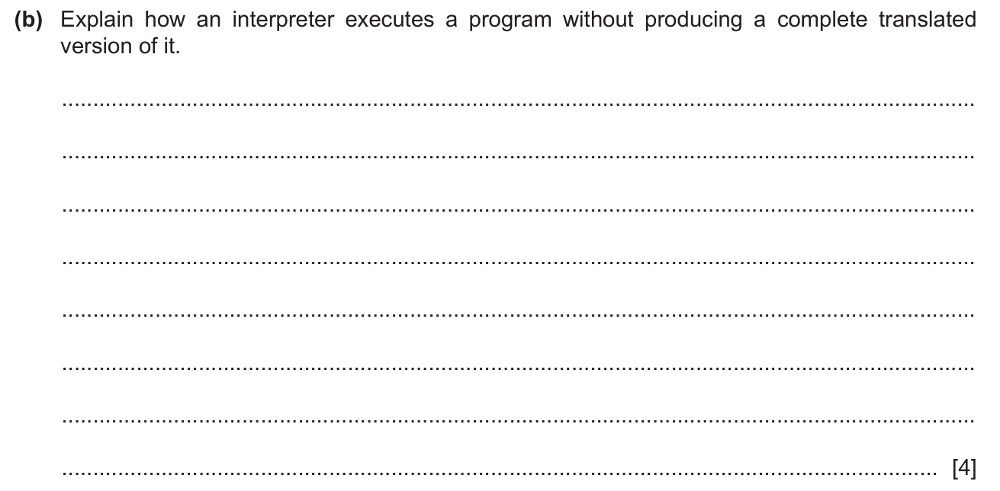

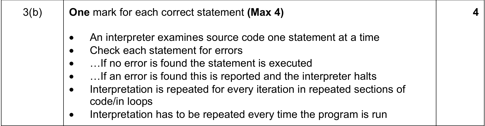

#### Describe the process of executing a program using an interpreter 与s21-31-3相同 s25-31-6 [4 marks] 

***One** mark for each mark point (**Max 4**)*  

-   MP1 The interpreter translates the source code one line at a time  
-   MP2 If the line is syntax error free it is executed  
-   MP3 It is not stored in executable format  
-   MP4 If an error is found, the program halts with an error message  
-   MP5 Each line must be translated every time it is run, including lines running multiple times for example in loops 

#### RPN and Stack s21-31-4

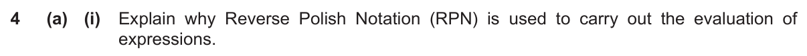

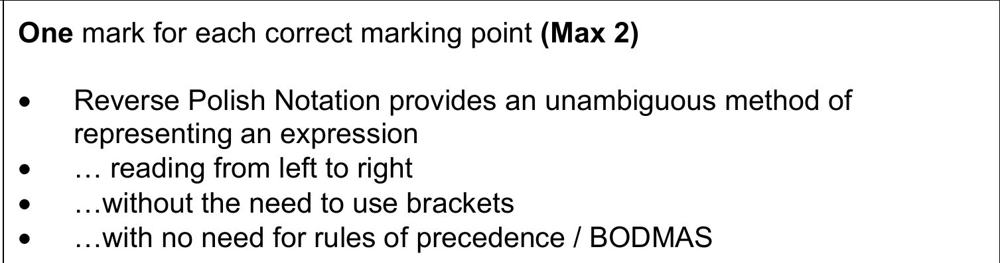

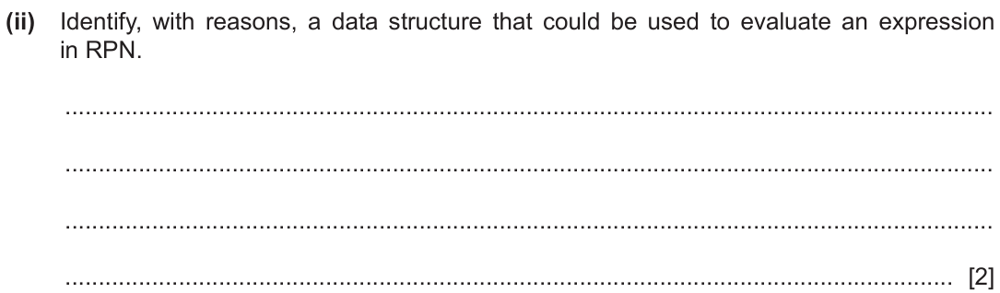

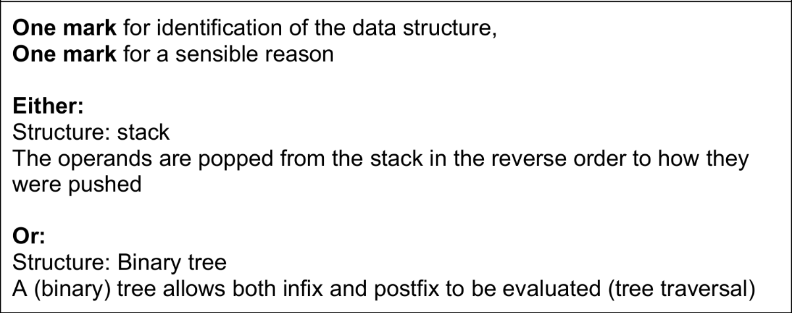

**如何把一个Infix expression 转换成RPN?**

正常的方法都是用队列和栈, 这个很麻烦, 而且是给电脑用的. 我们是人, 又不是电脑, 人脑跑电脑的算法是万万不行的, 就好像人眼能一眼看出是猫还是狗, 但是电脑要用CNN. 人脑算个积分求导毫不费力, 电脑要死要活. 所以我们用一点人的算法. 首先假设我们有一个method叫做$$RPN(Expression)$$. 用**s21-31-4b**举例
$$
(a-b)*(a+c)/7
$$
很显然, 我们定义RPN(e)是infix expression e的RPN, 首先我们找出来运算顺序就是从骨架往下拆
$$
RPN((a-b)*(a+c)) 7 /
$$
然后: 
$$
RPN(a-b) RPN(a+c) * 7/
$$
接着: 
$$
ab-ac+*7/
$$
就做出来了, 永远把算是拆分成一坨, 操作符, 一坨的, 然后递归求解. 记住, 一坨内部的运算优先级**必须$\geq$**一坨和一坨之间的操作数

#### Outline the purpose of lexical analysis during the compilation of a program w25-31-8 [2 marks]

**One** mark per mark point **(Max 2)**  

-   MP1 To convert the high-level source code / program into a sequence of tokens  
-   MP2 ... that can be sent to the parser for syntax analysis  
-   MP3 To create a symbol table  
-   MP4 To remove the unnecessary white space and comments from the code 

#### Explain what is meant by **lexical analysis** during program compilation [4]  s25-32-8

*One marks per mark point (Max 4)*

-   MP1 It is the first stage of compilation
-   MP2 White space and comments are removed 
-   MP3 It takes modified source code and breaks it into series of tokens 
-   MP4 Each tokens categorised and assigned types
-   MP5 Identifiers are stored in a symbol table
-   MP6 if the lexical analyser find invalid tokens, it generates an error . 
-   MP7 Acceptable data from the lexical analyser passes to the syntax analyser. 

## CH-17 Security

### 17.3 Protocols

#### Describe the purpose of the Secure Sockets layer (SSL) and Transport Layer Security (TLS) w21-31-8

[2 marks]

-   The SSL and TLS protocols provides communications security over the internet / network
-   ... they provide **encryption**
-   They enable two parties to identify and authenticate each other
-   ... and communicate with confidentiality and integrity

#### Secure Socket Layer (SSL) and Transport Layer Security (TLS) are two protocols. State **two** functions of SSL/TLS 和w21-31-8相同 [2 marks] s25-31-9

One mark for each mark point (Max 2)  

-   MP1 Ensure security/privacy when using the internet  
-   MP2 Data encryption  
-   MP3 Identification / authentication of client and server 

#### Give **two** examples of situations where use of SSL/TLS would be appropriate.  [2 marks] s25-31-9

One mark for each mark point (Max 2)  

-   MP1 When transmitting authentication data e.g. passwords, session cookies  
-   MP2 When transmitting data that must be protected from modification on its way to or from a server e.g. user input, or  results from the server  
-   MP3 When transmitting data classified as non-public. 

#### Explain how SSL / TLS protocols are used when a client-server communication is intialised w21-31-8

-   An SSL / TLS connection initiated by an application 
-   ... which becomes the client
-   The application which receives the connection which becomes the server
-   Every new session begins with a handshake (as defined by the (SSL / TLS) protocol)
-   The clients requests the digital certificate from the server // the server sends the digital certificate to the client
-   The client verifies the server's digital certificate
-   ... and obtains the server's public key
-   Then encryption algorithms are agreed
-   The symmetric 
-   ... session keys are generated / defined

#### Identify the **two** main protocols that form Transport Layer Security (TLS) **and** state the purpose of each. [4] s25-32-10

One mark for identifying a protocol and one mark for stating its purpose 

-   MP1 Handshake protocol
-   MP2 To establish a secure and reliable connection between two devices, systems or networks / Permits the web server and client to authenticate each other to make use of encryption algorithms
-   МР3 Record protocol 
-   MP4 Provides a secure and reliable way to send and receive data over a network ∥ To exchange records between the client and server / Responsible for securing application data end ensuring its integrity and authenticity during transmission / Encrypts and authenticates data exchanged between a client and a server / Deals with the format for data transmission.

### 17.4 Digital Signatures and Digital Certificates

#### Describe what is meant by a digital certificate s24-31-7 [3 marks]

*One mark per point (max 3)*    

-   MP1 A digital certificate is an electronic/online document.  
-   MP2 used to authenticate/prove the identity of a website/the online identity of an individual/organisation  
-   MP3 typically issued by a CA  
-   MP4 For example: it contains information identifying a website owner/individual and a public key 

#### Explain the role of a digital certificate in creating a digital signature s24-31-7 [2 marks]

*One mark per point (max 2)*  

-   MP1 The digital certificate provides the public key  
-   MP2 … that can be used to validate the private key associated with the organisation/website/digital signature 

#### Identify **two** items commonly found within a digital certificate w25-31-5 [2 marks]

#### Two from:  

-   Name of certificate holder // Subject  
-   Serial number  
-   Version number  
-   Expiration date // Start date // Validity (not before/not after)  
-   Certificate holder's public key // Subject public key  
-   Subject digital signature  
-   Certificate Issuer // Digital signature of CA  


## CH-18 Artificial Intelligence (AI)

### 18.1 Shortest Path Algorithm

#### Dijkstra s21-31-5

[图-最短路径-Dijkstra(迪杰斯特拉)算法_哔哩哔哩_bilibili](https://www.bilibili.com/video/BV1uT4y1p7Jy/) **伟大, 无需多言!**


#### Explain the use of graphs to aid Artificial Intelligence (AI) s21-31-5

**Max 3**

-   Artificial Neural Networks can be represented using graphs. 
-   Graphs provide structures for relationships
-   AI problems can be solves as finding a path in a graph
-   Graphs may be analysed by a range of algorithms
-   ... e.g. A*/Dijkstra algorithm
-   ... used in machine learning
-   Example of method e.g. Back propagation of errors/ regression methods

#### Describe the purpose of graph when used in an Artificial Intelligence (AI) system 与s21-31-5相同 [2 marks] s25-31-10 

One mark for each mark point (Max 2)  

-   MP1 A graph is used in AI to record relationships between entities  
-   MP2 ... using vertices / nodes and edges  
-   MP3 for example, to represent places on a map and the distances between them, in order to find the shortest route. 

### 18.2 Artificial Intelligence, Machine Learning and Deep Learning

#### state the reason for having multiple layers in an artificial neural network w21-31-9

[1 mark]

-   Enables deep learning to take place
-   Where the problem you are trying to solve has a higher level of complexity it requires more layers to solve
-   To enable the neural network to learn and make decisions on its own
-   To improve the accuracy of the result. 

#### Explain how artificial neural networks enable machine learning. w21-31-9

[4 marks]

-   Artificial neural networks are intended to replicate the way human brains work
-   Weights / values are assigned for each connection between nodes 
-   The data are input at the input layer passed into the system
-   They are analysed at each subsequent (hidden) layer where characteristics are extracted / outputs are calculated
-   ... this process of training/ learning is repeated many times to achieve optimum outputs // reinforcement being specifically programmed. 
-   The deep learning net will have created complex feature detectors 
-   The output layer provides the results
-   Back propagation (of errors) will be used to correct many errors that have been made.

#### Explain what is meant by Reinforcement Learning in relation to Artificial Intelligence. s24-32-9 [3 marks]

-   MP1 Reinforcement learning is a machine learning technique based on feedback / rewards / punishment.  
-   MP2 … in which an agent learns to behave in an environment by performing the actions and seeing the results of the  actions.  
-   MP3 … for each good action, the agent gets positive feedback / reward and each bad action receives negative feedback  / punishment.   
-   MP4 The agent learns automatically using feedback without any labelled data / specific instructions.  
-   MP5 Adjust node weightings to achieve the correct outcome. // Using feedback to improve its performance at  accomplishing similar tasks. 

#### Explain the use of artificial neural networks in Deep Learning 与w21-31-9相同(相似) [4 marks] s25-31-10

One mark for each mark point (Max 4)  

-   MP1 Artificial neural networks are designed to work in the same way as the human brain  
-   MP2 ANNs provide the architecture and algorithms for learning from the data  
-   MP3 They have a large number of connected processing units / nodes   
-   MP4 ... that are arranged in layers / interconnected and work together to process data   
-   MP5 Deep learning models learn from data by adjusting the weights/biases of the connections between neurons  
-   MP6 They use multiple hidden layers to extract complex features and to make predictions 

#### Explain what is meant by Deep Learning in relation to Artificial Intelligence (AI) s24-31-9 [3 marks]

*One mark per mark point (Max 3)*  

-   MP1 Deep learning learns by finding hidden patterns that are undetectable to humans.  
-   MP2 It structures algorithms in layers: input layer, hidden layers and output layer.  
-   MP3 … to create an artificial neural network to learn and make intelligent decisions on its own.  
-   MP4 It is trained using large quantities of unlabelled data.  
-   MP5 Deep learning requires/uses a large number of hidden layers.  MP6 … the larger the number of layers, the higher the level of success.  

#### Describe Deep Learning w25-31-7 [5 marks]

**One** mark for each mark point **(Max 5)**  

-   MP1 Deep learning is a branch of machine learning  
-   MP2 It makes use of artificial neural networks  
-   MP3 ... to work in a similar manner to the human/biological brain // ... neural  networks can be trained to process data  
-   MP4 It is a structure consisting of many interconnected layers  
-   MP5 ... input, hidden and output // the input layer feeds the first hidden layer, the last  hidden layer feeds the output  
-   MP6 ... gradually breaking down and analysing the data to find (hidden) patterns  
-   MP7 Deep leaning's feature extraction/learning involves how to detect  features/categories from data  
-   MP8 ... and can involve different types of supervision  
-   MP9 It works well with large data sets  
-   MP10 Deep learning uses back propagation of errors to adjust parameters/weightings  to refine its results / improve its accuracy. 

#### Describe the structure of a graph as used in Artificial Intelligence (AI) system [2] s25-32-6

*One mark per point (Max 2)*  

-   MP1 A graph uses vertices/nodes to identify/represent entities such as  destinations, people, etc  
-   MP2 Edges are used to connect nodes and can represent possible paths  between them // a path is the list of nodes connected by edges between two given nodes   
-   MP3 Nodes/edges can be labelled/weighted, and this is a weighting that  can be applied and used in the context of the application  
-   MP4 A cycle is a list of nodes that return to the same node. 

#### Explain how supervised learning and unsupervised learning differ from each other [4] s25-32-6

*One mark per mark point (Max 4)*  

-   MP1 Supervised learning uses labelled data // Unsupervised learning  makes use of unlabelled data.  
-   MP2 Labelled data means that known outcomes are applied to specific  inputs to help the AI predict outcomes.  
-   MP3 Supervised learning requires initial human input/training //  Unsupervised learning does not require human input/training.  
-   MP4 With unlabelled data in unsupervised learning, outcomes are not  known  
-   MP5  ... the AI has to search for hidden patterns/structures/clusters   
-   MP6  ... within the data in order to predict outcomes.

## CH-19 Computational Thinking and Problem Solving

### 19.1 Algorithms

#### Insertion sort 插入排序 s21-31-8

[数据结构合集 - 直接插入排序(算法过程, 效率分析, 稳定性分析)_哔哩哔哩_bilibili](https://www.bilibili.com/video/BV1tf421Q7eh/) 全体起立! 伟大, **再**一次!

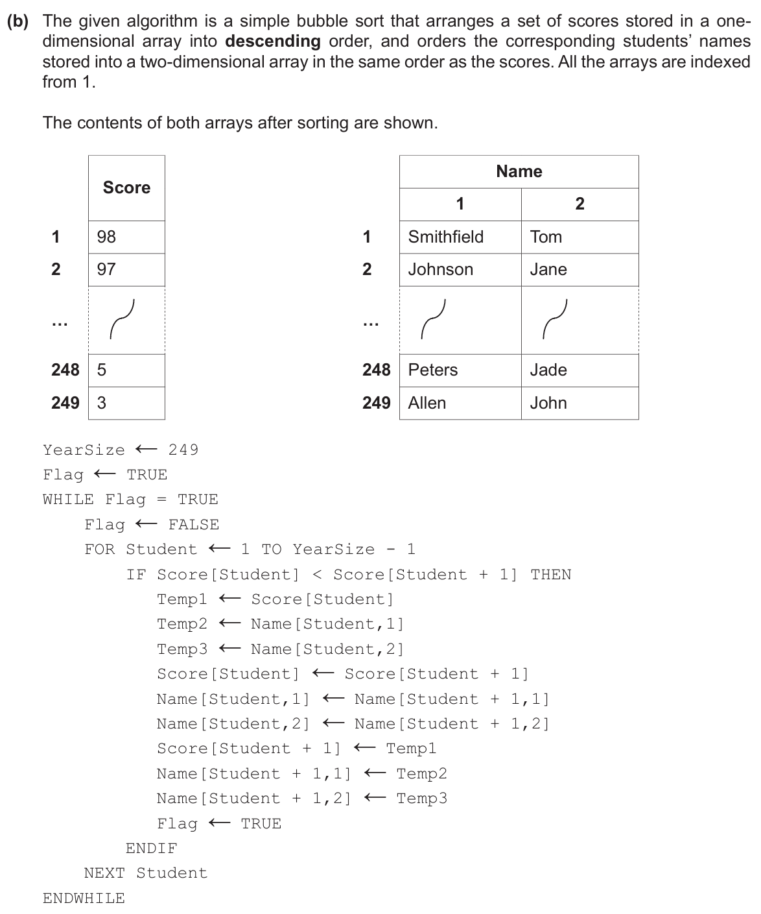

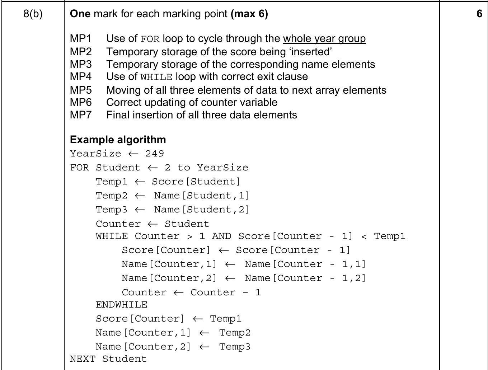

```pseudocode
// 假设我们要对数组Arr进行排序, 长度为N
DECLARE Temp: INTEGER
DECLARE Index: INTEGER
DECLARE Pointer: INTEGER
FOR Index <- 2 TO N
	Temp <- arr[Index]
	Pointer <- Index -1
	WHILE Pointer >= 1 AND Arr[Pointer] > Temp
		Arr[Pointer + 1] <- Arr[Pointer]
		Pointer <- Pointer -1
	ENDWHILE
	Arr[Pointer + 1] <- Temp
NEXT Index
```


### 19.2 Recursion

####  State **three** essential features of **recursion** w21-31-10

[3 marks]

-   Must have a base case / stopping condition
-   Must have a general case
-   ... which calls itself (recursively) // Defined in terms of itself
-   ... which changes its state and moves towards the base case. Unwinding can occur once the base case is reached. 

#### Explain the reasons why a stack is suitable Abstract Data Type (ADT) to implement recursion

[3 marks]

-   A stack is a LIFO data structure
-   Each recursive call is pushed onto the stack
-   ... and is then popped as the function ends
-   Enables backtracking / unwinding ... to maintain the required order

#### A stack is used to implement recursion. State the **three** essential features of recursion w25-31-9 [3 marks]

**One** mark per mark point **(Max 3)**  

-   MP1 A recursive algorithm must call itself / have a general case   
-   MP2 It must have a base case / have a stopping condition   
-   MP3 It must change its state and move towards the base case  

#### A binary tree can be used to implement recursion. Identify one feature of an algorithm that makes it beneficial to use recursion. Give one example of an application that could use a recursive algorithm.  [1+1] s25-32-11

One mark for feature and one mark for example (Max 2)   

-   Recursion is beneficial for algorithms when a problem naturally breaks  down into smaller versions of itself.   
-    ... such as calculating a factorial / mathematical series / Fibonacci /  compound interest / tree traversal / evaluation of RPN expressions.


## CH-20 Further Programming 

### 20.1 Programming Paradigm

#### Imperative (Procedural) programming language 面向过程 s21-31-9

Describe what is meant by an **imperative (procedural)** programming language [2 marks]

-   Imperative languages use variables
-   ... which are changed using (assignment) statements
-   ... they rely on a method of repetition / iteration
-   The statements provide a sequence of commands for the computer to perform
-   ... in the order written / given
-   ... each line of code changes something in the program run. 

#### Declarative programming language 声明式编程 s21-31-9

Describe what is meant by **a declarative** programming language [2 marks]

-   Instructs a program on what needs to be done instead of how to do it 
-   ... using facts and rues 
-   ... using queries to satisfy goals
-   Can be logical or functional
-   Logical - state a program as a set of logical relations
-   Functional - constructed by applying functions to arguments / use a mathematical style

#### State one reason why the attributes would be declared as ``` PRIVATE``` [1 mark] w24-31-9 

-   To ensure that the attributes are only accessible using the class’s own methods/within the class. 

### 20.2 File processing and exception handling

#### Explain what is meant by **exception handling**. Include a example if a possible cause of an exception in your answer w25-31-10 [3 marks]

One mark per mark point (Max 2)  

-   MP1 Exception handling is a process that responds to unwanted / unexpected  events when a program runs 
-   MP2 ... to prevent the program / computer from stopping unexpectedly    

One mark for example (Max 1) 

-   MP3 Programming errors   
-   MP4 User errors  
-   MP5 Hardware failure // losing connection to a device such as a printer 

## Object-oriented Programming (OOP)

#### Identify the object-oriented programming (OOP) feature whose function includes restricting external access of data [1 mark] s25-31-11

-   Encapsulation

#### Describe what is meant by the OOP feature **Inheritance** [2 marks] s25-31-11

One mark for each mark point (Max 2)  

-   MP1 Inheritance is where a derived class takes properties / behaviours   attributes / methods  
-   MP2 ... of a parent / super class / base class  
-   MP3 The attributes / methods / properties taken from the parent / super class / base class can also be extended /  copied / used / changed / overwritten / overridden in the subclass. 


## Pseudocode Guide

### File operation

#### 1. 顺序读取文件 ```READ```

##### i. 打开文件

```pseudocode
// 文件标识符是个字符串, 要用双引号包裹
OPENFILE <文件标识符> FOR READ
```

##### ii. 读取

```pseudocode
READFILE <文件标识符>, <STRING 变量>
```

>   注意, 在每次打开一个文件的时候, 其实我们维护了一个文件的指针. 初始状态下文件的指针指向第一行. 每次``` READFILE``` 会让这一行被读取, 然后指针自增. 在每个文件的最后一行会有一个隐含的 *EOF* 如果指针指向了 *EOF* 此时 ```EOF(<文件标识符>)```是 ```TRUE``` 


#### 2. 随机读取文件```RANDOM```

##### i. 打开文件

```pseudocode
OPENFILE <文件标识符> FOR RANDOM
```

##### ii. 移动指针

```
SEEK <文件标识符>, <地址>
// 文件标识符同上, 地址是个 INTEGER
```

>   这个时候我们与上面不同的是我们可以手动操作文件指针到我们想要他的地方了. 

##### iii. 读取Record

```pseudocode
GETRECORD <文件标识符>, <user-defined/primitive data type变量>
//把<文件标识符>的被当前指针指向的行读取出来放到<变量>中
//此时不会影响文件指针的地址, 下一次必须显示地使用SEEK
```

>   When this command is executed, the record that is read is assigned to the variable which must be of the
>   appropriate data type for that record (usually a user-defined type).  -- ***CS-2026-pseudocode-guide-for-teachers.pdf*** P26

##### iv. 写入Record

```pseudocode
PUTRECORD <文件标识符>, <user-defined/primitive data type变量>
```

>   When this command is executed, the data in the variable is inserted into the record at the file pointer. Any data
>   that was previously at this location will be <u>***replaced***</u>. -- ***CS-2026-pseudocode-guide-for-teachers.pdf*** P27

#### 3. 写入文件```WRITE```

##### i. 打开文件

```pseudocode
OPENFILE <文件标识符> FOR WRITE
```

在```WRITE```模式下, 如果系统中存在这个文件, 那么这个文件会被清空然后重写. 如果没有这个文件, 那么会创建这个文件然后写入. 此时文件指针会指向文件的第一行

##### ii. 写入文件

```pseudocode
WRITEFILE <文件标识符>, <STRING 变量>
```

#### 4.插入文件```APPEND```

##### i. 打开文件

```pseudocode
OPENFILE <文件标识符> FOR APPEND
```

在```APPEND```模式下, 系统中存在这个文件. 此时文件指针会指向文件的最后一行的下一行 (忽略*EOF*)

##### ii. 写入文件

```pseudocode
WRITEFILE <文件标识符>, <STRING 变量>
```


#### **<u>读取完记得关闭文件</u>**

```
CLOSEFILE <文件标识符> 
```

### User-defined Data Types

#### Record

```pseudocode
TYPE <Record class>
	//只放数据, 全是public
	DECLARE <attr1>: <type1>
	DECLARE <attr2>: <type2>
	DECLARE <attr3>: <type3>
	...
ENDTYPE
```

e.g.

```pseudocode
TYPE StudentRecord
    DECLARE LastName : STRING
    DECLARE FirstName : STRING
    DECLARE DateOfBirth : DATE
    DECLARE YearGroup : INTEGER
    DECLARE FormGroup : CHAR
ENDTYPE
```


#### Class

```pseudocode
CLASS <Class Name>
	PUBLIC <pu1>: <type1>
	PUBLIC <pu2>: <type2>
	...
	PRIVATE <pr1>: <type3>
	PRIVATE <pr2>: <type4>
	//这些都是他们的共有和私有变量
	PUBLIC PROCEDURE NEW(<para1>: <type1> ...)
		...
	ENDPROCEDURE //构造函数
	PUBLIC FUNCTION ....
	PRIVATE FUNCTION ...
	PUBLIC PROCEDURE ... 
	...
ENDCLASS
```

调用的时候

```pseudocode
DECLARE <obj>: <Class Name>
<obj> = <Class Name>(<para1>, ...)
<obj>.<pu1>
<obj>.<func1>(...)
```

#### Enumerated Data Type

```pseudocode
TYPE <identifier> = (value1, value2, value3, ...)
DECLARE <entity>: <identifier>
// 然后就可以赋值了, 只能赋值enum内的
```

e.g.

```pseudocode
TYPE Season = (Spring, Summer, Autumn, Winter)
```


#### Pointer

```pseudocode
TYPE <identifier> = ^<data type>
```

e.g.

```pseudocode
TYPE TInt: ^INTEGER
DECLARE ptr: TInt
DECLARE num: INTEGER
num <- 5
ptr <- ^num //取地址
OUTPUT ptr^ //5 根据地址取数据
```


#### Set

```pseudocode
TYPE <identifier1> = SET OF <data type>
DEFINE <identifier2> (value1, value2, value, … ) : <identifier1>
```

e.g.

```pseudocode
TYPE LetterSet = SET OF CHAR
DEFINE Vowels ('A','E','I','O','U'): LetterSet
```
